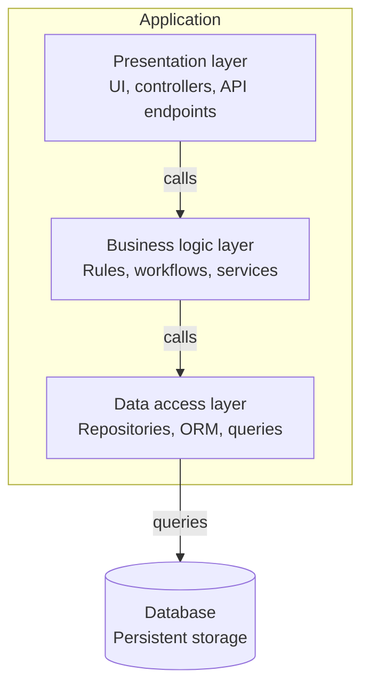
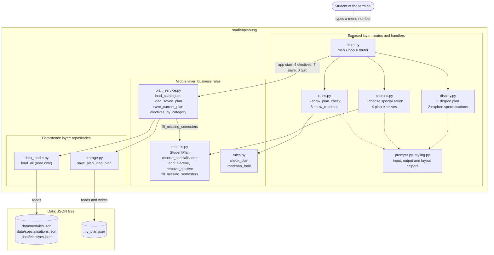

Layered architecture representation for better understanding our system and how the call flow works. It can be seen, in a simplified manner, as an onion with 3 layers:

- outer layer is what exposes our system to the world
- middle layer is where data is treated and served up or down, depending on the direction the data is travelling
- inner layer is what gives access to the data

Template shape of layered architecture in SWE:

Layered architecture representation of studienplanung:

